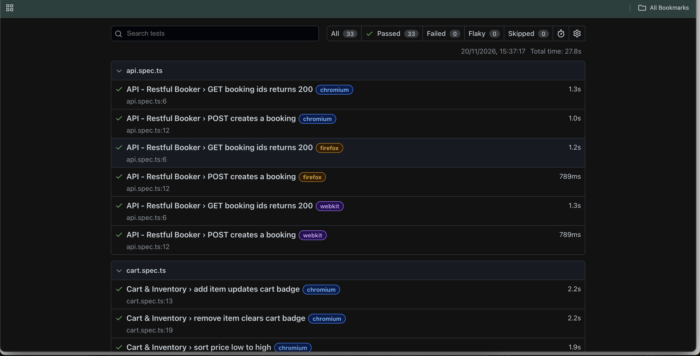

# playwright-saucedemo-framework


End-to-end UI and API test automation framework built with **Playwright + TypeScript**, using the **Page Object Model**.

## Application Under Test
- UI: [SauceDemo](https://www.saucedemo.com)
- API: [Restful Booker](https://restful-booker.herokuapp.com)

## Tech Stack
Playwright · TypeScript · Page Object Model · GitHub Actions · HTML Reports

## Coverage
| Area | Scenarios |
|---|---|
| Login | Valid, invalid, locked-out user, required-field validation |
| Inventory/Cart | Add/remove items, cart badge, price sorting |
| Checkout | End-to-end order, form validation |
| API | GET and POST booking |

## Project Structure
```
pages/       Page Objects
tests/       Test specs (UI + API)
test-data/   Test data
.github/     CI pipeline
```

## Run Locally
```bash
npm install
npx playwright install
npx playwright test
npx playwright show-report
```

## Features
- Cross-browser: Chromium, Firefox, WebKit
- Screenshots on failure, traces on retry
- CI runs on every push and pull request

## Report

